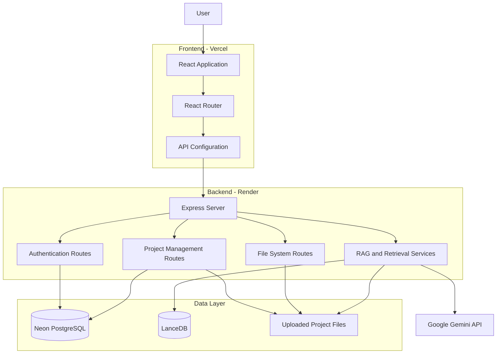
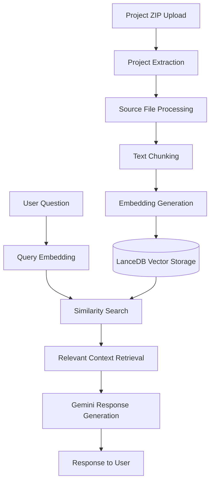

::: {align="center"}
# DevDoc

### AI-Powered Codebase Intelligence Platform

Understand your codebase. Explore project structures. Ask questions
about your code with AI.

:::Overview
DevDoc is an AI-powered codebase intelligence platform designed to help
developers understand and navigate their software projects more
efficiently.

As software projects grow, understanding their architecture, file
relationships, and implementation details becomes increasingly
challenging. DevDoc addresses this problem by combining project
exploration, code indexing, vector-based retrieval, and AI-powered
question answering in a unified workspace.

Users can upload their codebases, explore project files, index source
code, and interact with an AI assistant that retrieves relevant code
context to generate project-specific responses.

The platform uses a Retrieval-Augmented Generation (RAG) approach to
make AI interactions more relevant to the uploaded codebase.

Live Application: https://dev-doc-ai-2-0.vercel.app
Table of Contents
- Key Features
- Application Screenshots
- Technology Stack
- System Architecture
- How It Works
- Project Structure
- API Overview
- Getting Started
- Environment Variables
- Deployment
- Technical Highlights
- Known Limitations
- Future Scope
- Author
Key Features
1. User Authentication
- User registration and login.
- Session-based authentication.
- Persistent session storage using PostgreSQL.
- Protected project and workspace operations.
- User-specific project management.
2. Project Management
- Upload software projects through ZIP files.
- Maintain a personal project library.
- Activate projects for workspace exploration.
- Rename and delete projects.
- Isolate project data between authenticated users.
3. Codebase Exploration
- Browse uploaded project structures.
- Navigate directories and files.
- Select and inspect source files.
- View file contents within the workspace.
4. AI-Powered Codebase Intelligence
- Index uploaded project source files.
- Generate embeddings for code chunks.
- Store vector representations using LanceDB.
- Retrieve relevant code context through similarity search.
- Ask natural-language questions about an indexed project.
- Generate context-aware responses using Google's Gemini API.
5. Integrated Developer Workspace
- Centralized project exploration and AI interaction.
- File explorer and code viewing interface.
- AI question-and-answer workspace.
- Project library and project management interface.
Application Screenshots
Add actual application screenshots in the locations below. A suggested
location is docs/images/ in the repository.
1. Welcome Page
   screenshots/Welcome.png
2. Authentication
  screenshots/Login.png
3. Project Dashboard
  screenshots/overview.png
4. Project Library
  screenshots/Project.png
5. Codebase Workspace
  screenshots/Workspace.png
Technology Stack
DevDoc follows a full-stack architecture consisting of a React frontend,
Express backend, relational database, vector database, and an external
generative AI service.

  Layer                 Technology             Purpose
  Frontend              React                  User interface
Frontend Tooling      Vite                   Development and production builds
Routing               React Router           Client-side navigation
Backend               Node.js                Server-side runtime
Backend Framework     Express.js             REST API development
Database              PostgreSQL             Users, sessions and project metadata
Database Hosting      Neon                   Managed PostgreSQL
PostgreSQL Client     pg                     PostgreSQL connectivity
Session Management    express-session        Authentication sessions
Session Store         connect-pg-simple      PostgreSQL-backed sessions
AI Model              Google Gemini          Response generation
Embeddings            Gemini Embedding API   Vector representations
Vector Database       LanceDB                Embedding storage and retrieval
Frontend Deployment   Vercel                 Frontend hosting
Backend Deployment    Render                 Backend hosting
Version Control       Git and GitHub         Source code management
System Architecture
DevDoc uses a client-server architecture with separate frontend and
backend deployments.
High-Level Architecture

Main Architectural Components
Frontend

The React application provides the user interface, authentication
screens, project library, file explorer, and AI workspace.

Backend

The Express server manages authentication, sessions, project operations,
file access, indexing, retrieval, and AI communication.

Relational Database

PostgreSQL stores user information, session information, and project
metadata. Project ownership is maintained through user-specific
associations.

Vector Storage

LanceDB stores vector embeddings generated from project content and
supports similarity-based retrieval.

AI Integration

Google Gemini is used for generating embeddings and producing responses
based on retrieved project context.
How It Works
DevDoc follows a project ingestion and Retrieval-Augmented Generation
workflow.
1. Project Upload
The authenticated user uploads a project as a ZIP file.

The backend processes the uploaded archive and stores the extracted
project files within the corresponding user's project directory.
2. Project Registration
Project information and ownership metadata are stored in PostgreSQL.

Each project is associated with its authenticated owner.
3. Codebase Indexing
When a project is indexed:
1. The backend accesses the selected project.
2. Relevant source files are processed.
3. Project content is divided into smaller chunks.
4. Embeddings are generated using the Gemini embedding service.
5. Vector representations are stored in LanceDB.
4. Context Retrieval
When a user asks a question:
1. The question is processed by the backend.
2. A query embedding is generated.
3. Similarity search retrieves relevant indexed code chunks.
4. Retrieved context is prepared for the language model.
5. AI Response Generation
The retrieved context and user question are passed to the Gemini
generation service.

The generated response is returned to the frontend and displayed in the
AI workspace.
RAG Workflow

Project Structure
The repository is organized into separate frontend and backend
applications.
DevDoc-AI---2.0/
│
├── devdoc/                         # React frontend
│   ├── public/
│   ├── src/
│   │   ├── components/             # Reusable UI components
│   │   ├── pages/                  # Application pages
│   │   ├── App.jsx
│   │   ├── AppRouter.jsx
│   │   └── api.js                  # Centralized API configuration
│   ├── package.json
│   └── vite.config.js
│
├── devdoc-backend/                 # Express backend
│   ├── routes/                     # API route handlers
│   │   ├── auth.js
│   │   └── ...
│   ├── utils/                      # Backend utility services
│   │   └── vectorStore.js
│   ├── db.js                       # PostgreSQL connection
│   ├── server.js                   # Express application entry point
│   ├── package.json
│   ├── user-projects/              # Uploaded project storage
│   ├── vector-store/               # Local LanceDB storage
│   └── upload-temp/                # Temporary ZIP uploads
│
└── README.md
Note: Runtime-generated storage directories are not included in the Git
repository. This is a representative structure; consult the repository
for the complete current file tree.
API Overview
The backend exposes REST endpoints under the /api namespace.
Authentication
  Method   Endpoint               Description
  POST     /api/auth/register   Register a new user
POST     /api/auth/login      Authenticate a user
GET      /api/auth/me         Retrieve the current authenticated user
POST     /api/auth/logout     Destroy the current session
Project Management
  Method   Endpoint          Description
  GET      /api/projects   Retrieve the user's projects
POST     /api/upload     Upload a project
POST     /api/activate   Activate a project
POST     /api/rename     Rename a project
DELETE   /api/delete     Delete a project
Codebase and AI Operations
  Method   Endpoint          Description
  GET      /api/files      Retrieve project file structure
GET      /api/file       Retrieve an individual file
GET      /api/project    Retrieve project information
POST     /api/index      Index project content
POST     /api/retrieve   Retrieve relevant indexed context
POST     /api/chat       Generate an AI response

This is a high-level route overview. Refer to the backend route
handlers for exact request parameters, payload structures, and response
formats.
Getting Started
Follow these instructions to run DevDoc locally.
Prerequisites
Make sure the following are installed:
- Node.js and npm
- Git
- A PostgreSQL database (Neon or a local PostgreSQL instance)
- A Google Gemini API key
1. Clone the Repository
git clone https://github.com/tyagiaradhya099-arch/DevDoc-AI---2.0.git
cd DevDoc-AI---2.0
2. Configure the Backend
cd devdoc-backend
npm install
Create a .env file inside the devdoc-backend directory and add the
required environment variables.
3. Configure the Frontend
Open another terminal:
cd devdoc
npm install
Create a .env file inside the frontend directory.

Add the frontend API URL:
VITE_API_URL=http://localhost:5000
4. Start the Backend
From the devdoc-backend directory:
npm start
The backend runs on port 5000 by default, unless another port is
configured.
5. Start the Frontend
From the devdoc directory:
npm run dev
Vite will display the local development URL in the terminal, usually:
http://localhost:5173
6. Open DevDoc
Open the frontend URL in your browser, register an account, and begin
exploring the application.
Environment Variables
The application requires environment variables for database
connectivity, authentication, AI integration, and frontend-backend
communication.
Backend Environment Variables
Create devdoc-backend/.env.

  Variable           Description
  PORT             Backend server port; defaults to 5000 locally
DATABASE_URL     PostgreSQL connection string
SESSION_SECRET   Secret used to sign session cookies
GEMINI_API_KEY   Google Gemini API key
CLIENT_URL       Allowed frontend origin for CORS
NODE_ENV         Application environment

Example:
PORT=5000
DATABASE_URL=your_postgresql_connection_string
SESSION_SECRET=your_session_secret
GEMINI_API_KEY=your_gemini_api_key
CLIENT_URL=http://localhost:5173
NODE_ENV=development
Frontend Environment Variables
Create devdoc/.env.
VITE_API_URL=http://localhost:5000
Important: Never commit .env files, database credentials, API
keys, or session secrets to GitHub.
Deployment
DevDoc is deployed using separate hosting services for the frontend and
backend.

  Component   Platform   Responsibility
  Frontend    Vercel     React application hosting
Backend     Render     Express API hosting
Database    Neon       Managed PostgreSQL
Frontend Deployment
The frontend is deployed on Vercel.
- Root Directory: devdoc
- Framework: Vite
- Build Command: npm run build
- Output Directory: dist
- Environment Variable: VITE_API_URL
Backend Deployment
The backend is deployed on Render.
- Root Directory: devdoc-backend
- Runtime: Node.js
- Build Command: npm install
- Start Command: npm start
Required backend environment variables must be configured in the Render
dashboard.
Cross-Origin Configuration
The backend uses CORS configuration to allow requests from the deployed
frontend.

The CLIENT_URL environment variable specifies the frontend origin
permitted to communicate with the backend.

The frontend uses VITE_API_URL to identify the backend API.
Production URL
Live Application: https://dev-doc-ai-2-0.vercel.app
Technical Highlights
The project demonstrates the implementation of several full-stack
development concepts:
- Full-stack application development using React and Express.
- REST API design and frontend-backend integration.
- Session-based authentication.
- PostgreSQL database integration.
- User-specific project ownership and data isolation.
- File upload and filesystem operations.
- Codebase processing and text chunking.
- Embedding generation and vector similarity search.
- Retrieval-Augmented Generation (RAG).
- Integration with an external generative AI API.
- Environment-based configuration.
- Production deployment and CORS configuration.
Known Limitations
- The application depends on the availability and usage limits of the
  Gemini API.
- AI responses depend on the quality and relevance of indexed project
  content.
- Vector storage and uploaded project files currently use local
  backend filesystem storage.
- The current free Render deployment does not provide persistent disk
  storage. Consequently, uploaded project files and LanceDB data may
  be lost when the backend restarts or redeploys.
- The application is intended as a portfolio and learning project
  rather than a production-grade multi-tenant commercial service.
Future Scope
Potential areas for future development include:
- Persistent cloud storage for uploaded project files.
- Managed or remotely hosted vector database infrastructure.
- Improved code parsing and retrieval strategies.
- Support for larger codebases.
- Enhanced retrieval accuracy and response quality.
- Additional developer productivity capabilities.
Author
Aradhya Tyagi

Computer Science & Engineering | Data Science
- GitHub:
  @tyagiaradhya099-arch
- Project Repository: DevDoc AI
  2.0
- Live Application: DevDoc
::: {align="center"}
**DevDoc --- Making Codebases Easier to Understand.**
:::
